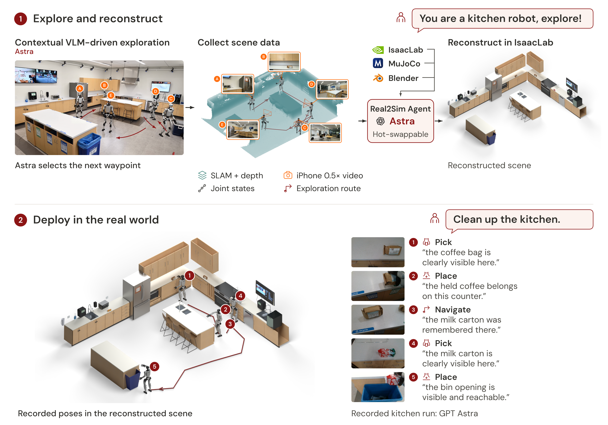

<h1 align="center">HomeBody: A Humanoid That Explores, Remembers, and Acts on Its Own</h1>

<p align="center">
  <a href="https://www.linkedin.com/in/gio-huh-789188374/">Gio Huh</a><sup>1,2</sup> &nbsp;&nbsp;
  <a href="https://www.linkedin.com/in/caydengu/">Cayden Gu</a><sup>2</sup> &nbsp;&nbsp;
  <a href="https://www.takaratruong.com/">Takara E. Truong</a><sup>2</sup> &nbsp;&nbsp;
  <a href="https://profiles.stanford.edu/c-karen-liu">C. Karen Liu</a><sup>2,†</sup> &nbsp;&nbsp;
  <a href="https://guytevet.github.io/">Guy Tevet</a><sup>2,†</sup>
</p>

<p align="center">
  <sup>1</sup> Caltech &nbsp; <sup>2</sup> Stanford University &nbsp; <sup>†</sup> Equal advising
</p>

<p align="center">
  <a href="https://tml.stanford.edu/homebody/">
    
  </a>
</p>

<p align="center">
  
</p>

### Code release schedule

| Target date | Release | Scope | Status |
|---|---|---|---|
| October 5, 2026 | **SIM** | Simulation environment with navigation and pick-and-place. | Released |
| October 16, 2026 | **REAL2SIM** | Exploration and scene-reconstruction pipeline. | Released |
| October 26, 2026 | **REAL** | Real-world deployment code and setup instructions. | Released |

## Installation

**1.** Get the code and create a Python 3.11+ environment:
```bash
git clone https://github.com/Stanford-TML/homebody.git && cd homebody
conda create -n homebody python=3.11 -y && conda activate homebody
```

**2.** Install the package (it brings MuJoCo, PyTorch and the console). Keep `-e`: it runs
from this folder's assets.
```bash
pip install -e .
```

**3.** Give it a model. Install and log in to one of the CLIs, or export an API key:
```bash
npm install -g @openai/codex && codex login               # for --model astra
npm install -g @anthropic-ai/claude-code && claude        # for --model opus, then /login
export OPENAI_API_KEY=...         # or ANTHROPIC_API_KEY=..., for the -api models
```

**4.** Check that everything is in place. `check` starts nothing, and `provider-check` sends the
model one short request:
```bash
homebody check
homebody provider-check --model astra
```

<details>
<summary>No GPU, or on a Mac? (SIM)</summary>

For SIM a GPU is optional: the walking policy runs on the CPU when CUDA is missing. Rendering is
chosen for you (`egl` on Linux with a GPU, `osmesa` on Linux without one, `cgl` on macOS).
Set `MUJOCO_GL` to override it. Linux without a GPU needs `sudo apt install libosmesa6`, and
`pip install torch --index-url https://download.pytorch.org/whl/cpu` before step 2 skips the
large CUDA download. SIM runs on macOS (Apple silicon) and Linux; REAL2SIM and REAL need the Linux/amd64
workstation with an NVIDIA GPU described next.
</details>

### 🔧 Robot hardware, for REAL2SIM and REAL

A Unitree G1 with its MID-360 LiDAR, and a Linux/amd64 workstation or laptop with an NVIDIA GPU (an
RTX 4080 or 4090 is preferred) and Docker, plugged into the robot's Ethernet. 3D-print the chest mount
(`hardware/g1_iphone_mount.stl`), fit your iPhone in it and connect the phone to the G1's Jetson with a
USB-C to USB-C cable. Put the robot's SSH user, IP and password and the phone stream in `configs/exploration.toml`
(`[robot]`, `[iphone]`), then install:

```bash
bash hardware/g1/install.sh          # or: --robot unitree@192.168.123.164 --password 123 --iface enp3s0
```

The [exploration guide](guides/exploration.md) and the [phone guide](guides/phone-camera.md)
have the details.

**For REAL**, also install the `real` extra and download the tracking weights, which are not in the
repository (run from the checkout root):
```bash
pip install -e '.[real]'
mkdir -p .cache/models
curl -fL -o .cache/models/sam2.1_hiera_tiny.pt https://dl.fbaipublicfiles.com/segment_anything_2/092824/sam2.1_hiera_tiny.pt
echo "7402e0d864fa82708a20fbd15bc84245c2f26dff0eb43a4b5b93452deb34be69  .cache/models/sam2.1_hiera_tiny.pt" | sha256sum -c -
```
The head camera's depth engine is built for your GPU as the [head RGB-D guide](guides/head-rgbd.md) describes.

## Usage

### 💻 SIM

The HomeBody agent drives a Unitree G1 humanoid through a real2sim kitchen in MuJoCo, one
skill at a time, deciding from the robot's camera, its map and its memory of the scene.
The walking policy, arms, Dex3 hands and every object are simulated with full physics.
The simulation reproduces the long-horizon runs in the SRC Kitchen.

**Try it out in interactive mode.** Open http://127.0.0.1:8080, type a task and press **Start task**
(the console has no login, so keep `--host` on localhost unless the network is trusted):
```bash
homebody --env src_kitchen --model astra
```

**Run one task without the console:**
```bash
homebody --headless --env src_kitchen --model opus --task "Put the coffee bags on the island and throw away the used cartons."
```

**Run headless with scripted moves** (no model, four objects moved in one run):
```bash
python tools/check_manipulation.py --sequence configs/continuous_four.json --no-visuals
```

**After a run.** Every run is saved under `runs/session-<time>-<id>/`.

```bash
run=$(ls -d runs/session-* | tail -1)   # the newest run
python tools/timeline.py $run            # step-by-step decisions and results
python tools/score_session.py $run       # did every object end up in place
python tools/compose_cockpit.py $run     # a replay video, cockpit.mp4
```

<details>
<summary>Things to try</summary>

Type any of these into the console, or pass one with `--task`. Each worked for both models
in every run (two runs per model, scored by `configs/waves/fun.json`).

- *The juice is for whoever sits at the round table nearest the recycling bin. Take it to them.*
- *Show the red and white carton to someone at the island, then put it back where it was.*
- *If the orange juice is next to the toaster, move it to the island; otherwise throw it away.*
- *Swap the two coffee bags between their counters.*
- *Throw away the carton that isn't orange juice.*

**Or give it a wrong memory.** Move an object before the run. The scan still describes and
places it where it was, so the model has to notice and go looking. This takes longer, often several
minutes of searching, and is the hardest test here. In recent runs Opus found the carton both
times, once after 29 minutes.
```bash
homebody --model opus --place-object juice_carton=3.19,3.42,-1.86 --task "Throw the orange juice carton in the recycling bin."
```
`--place-object` takes the object's map x and y in metres and its yaw in radians.
</details>

<details>
<summary>Models, environments and settings</summary>

**Models.** Pick one with `--model` (default `astra`). Each runs through its CLI with your
login, or with `-api` through the API with a key (e.g. `opus-api`). Only `astra` and `opus`
were validated, and smaller models fail more often.

| Codex (OpenAI) | Claude (Anthropic) |
|---|---|
| `astra`: GPT-6 Astra | `opus`: Claude Opus 5.5 |
| `sol`: GPT-5.6 Sol | `fable`: Claude Fable 5.1 |
| `luna`: GPT-5.6 Luna | `sonnet`: Claude Sonnet 5.5 |
| `terra`: GPT-5.6 Terra | `haiku`: Claude Haiku 4.5 |

**Environments.** Pick one with `--env <name>`. Each is a real2sim room, reconstructed from the real world,
in a folder under `assets/real2sim/`. For now there is `src_kitchen` (the default), a kitchen
with two coffee bags and two cartons, and more are coming soon.

**Settings.** Defaults are in `src/homebody/session/config.py`. `configs/simulation.toml` and
the scene's `settings.toml` override them, and `--settings my.toml` overrides those with
only the values it names.
</details>

### 📷 REAL2SIM

Check, explore (open http://127.0.0.1:8099 and press **Start exploration**; **STOP** ends the run,
recorded under `runs/explore/`), then reconstruct the recording into a HomeBody scene with a coding agent:

```bash
homebody real2sim explore check
homebody real2sim explore --task "Explore this room." --iphone-input "$PHONE_STREAM_URL"
homebody real2sim reconstruct --exploration-data runs/explore/<run> --output assets/real2sim/my_room --task "Reconstruct the observed room"
homebody --env my_room                 # the new scene runs in SIM like src_kitchen
```

The coding agent reconstructs the scene from the capture on its own, following the
[HomeBody REAL2SIM skill](.agents/skills/homebody-real2sim/SKILL.md); the [REAL2SIM guide](guides/real2sim.md)
describes the scene package it delivers. Settings are the `[group]` tables in `configs/exploration.toml`,
overridden by `--settings my.toml`.

\*Our REAL2SIM results use an internal SuperOdometry version with a better localization stack. This release ships
the vanilla open-source SuperOdometry, so REAL2SIM results can vary significantly; we will push updates that improve it.

### 🚀 REAL

The HomeBody agent runs the same skills (navigate, pick, place, and the `remember`/`recall` photo
memory) on a physical Unitree G1 with its Dex3 hands and head D435i camera, through the same console as SIM.

**Start the body host**, with the robot supported:
```bash
homebody real2sim explore setup --iface enp3s0   # your robot Ethernet interface
```

**Stand the robot.** On the G1 remote, press **Y** to initialize the pose and, after the ramp, **A** for
standing mode, where the walking policy balances the robot.

**Run a task.** Check the local files and start the console, then open http://127.0.0.1:8080, type a task and
press **Start task**; **Pause**, **STOP task** and **End session** leave the robot standing:
```bash
homebody check --backend real --real-config configs/real.local.json   # local files only; starts nothing
homebody run --backend real --real-config configs/real.local.json --memory kitchen
```

**Stop.** The legs keep running after a task, **STOP task** or **End session**, so the robot stays balanced.
Support the robot, press **B** (or **L1+R1**) to stop the policy and damp every joint, and only then
disconnect the Ethernet.

The [REAL guide](guides/real-long-horizon.md) covers setup, calibration, `configs/real.local.json` and
the supervised qualification steps.

\*Our REAL long-horizon results and demos use an internal SuperOdometry version with a better localization
stack. This preliminary release ships the vanilla open-source SuperOdometry, so REAL results can vary
significantly; we will push updates that improve it. Run REAL only supervised, with the robot supported and
the remote in hand.

## Contributing

The skills, the grasp planner and the prompt are a working baseline with plenty of room to
grow, and every pull request and bug report helps.

<details>
<summary>How do I add a skill?</summary>

Write one module in `src/homebody/skills/`, for example `push.py`, and add its name to
`SKILLS` in `skills/registry.py`. The SIM registry and the REAL task registry both come from
this list; the REAL composition adds checked navigation, strict one-object manipulation and
memory. The module declares

- `PROMPT`, one line starting with `push: ` that tells the model what the skill does and
  what arguments it takes
- `NEEDS`, the `Robot` commands it uses (`OPTIONAL` lists commands it uses when the backend has
  them), and `FAILURES`, the result codes it can return
- `prepare(arguments, selected, current, planning)`, which plans from one camera frame
- `execute(plan, ctx)`, which runs the plan and returns a `Result` (and `abort`, if it must
  undo something)

`navigate_sim.py`, `pick.py` and `place.py` are full examples, and `tests/test_custom_skill.py`
builds a new skill, `wave`, from scratch and runs it. A skill with tunable numbers also adds a
settings group in `session/config.py` and `session/settings.py`. A SIM skill talks to the robot
only through `Robot`, so it runs unchanged on a real backend, and its prompt line describes the
robot, not one kitchen or task. The skills the exploration model can call are listed in
`real2sim/exploration/skills.py` and declare their commands against the live actions (`SURFACE`)
instead of `Robot`. Adding one takes four places: its module, its name in `LIVE_SKILLS`, its branch in
`vlm_pick.parse_decision` and its branch in `decision_interpretation.py`; the
[architecture guide](guides/architecture.md) shows where each piece goes.
</details>

<details>
<summary>How do I add a model?</summary>

A model from a service that is already supported (Codex, Claude Code, the OpenAI or Claude
API) is one line in `MODELS` in `src/homebody/session/config.py`.

A new service needs a provider, one class in `src/homebody/vlm/` with a `LABEL`, the
`EXECUTABLE` or API `KEY` it needs, and a `generate` method that sends the prompt and images
and returns a `Decision`. Add it to `PROVIDERS` in `vlm/catalog.py`. `vlm/claude.py` is a
short example.
</details>

<details>
<summary>How do I add a scene?</summary>

A scene is one folder under `assets/real2sim/`, run with `--env <folder>`. It needs
`scene.xml` (MuJoCo), `task_scene.json` (the robot's start and the movable objects),
`map.npz` (the navigation map), `physics.json` and `semantics.json` (the labels and
descriptions the model is given), and optionally a `settings.toml`. `src_kitchen/` is the
example. Follow the [scene build and validation steps](guides/real2sim.md)
for a new room. `tools/verify_assets.py` checks the repository's shipped manifest;
it does not certify a new scene's geometry or physics.
</details>

<details>
<summary>How do I add a robot backend?</summary>

Implement the `Robot` protocol in `src/homebody/primitives/robot.py`, nine members covering
time, camera frames, measurements and commands to the base, arms and hands.
`backends/mujoco.py` implements the simulator; `backends/real.py` composes calibrated
observations and G1 commands for REAL tasks. The G1 driver lives in `backends/g1/`. A hardware backend also needs
capture timestamps, a deadman that stops the base, an operator stop and calibration
([CLAUDE.md](CLAUDE.md) has the list).
</details>

<details>
<summary>How do I report a bug?</summary>

Open an issue with the command you ran, what you expected and what happened. If it happened
in a run, attach the output of `python tools/timeline.py runs/session-<time>-<id>` and, if
you can, the replay video from `tools/compose_cockpit.py`.
</details>

<details>
<summary>What is in this repository</summary>

| Path | What it is |
|---|---|
| `src/homebody/session/` | The decision loop, settings and recording, for SIM and for exploration |
| `src/homebody/skills/` | The task skills (`navigate`, `pick`, `place`; navigation in `navigate_sim.py` for SIM and `navigate_real/` for REAL2SIM and REAL) and the skills exploration runs on the G1 |
| `src/homebody/primitives/` | The `Robot` interface, observation records and the live sensor and navigation primitives |
| `src/homebody/vlm/` | The model providers and the prompt |
| `src/homebody/backends/` | The MuJoCo robot and the G1 driver |
| `src/homebody/real2sim/` | Exploration (live map, decisions, capture), export and reconstruction |
| `src/homebody/motion/exploration/` | Gait, drive math and localization checks for the G1 |
| `hardware/g1/` | The G1 launcher and the SLAM, recorder and phone relay recipes |
| `configs/` | `simulation.toml` and `exploration.toml` settings, wave sets and the capture schema |
| `.agents/skills/homebody-real2sim/` | Capture audit and reconstruction workflow |
| `assets/` | The robot, its walking policy and the SRC Kitchen scene |
| `evaluation/` | The physics scorer |
| `tools/` | Checks, scoring, timelines, replays and scene building |

[CLAUDE.md](CLAUDE.md) explains how the code fits together, and the
[architecture guide](guides/architecture.md) shows the SIM and REAL2SIM layers.
</details>

## Bibtex

If you find this code useful in your research, please cite:

```bibtex
@misc{huh2026homebody,
  author = {Huh, Gio and Gu, Cayden and Truong, Takara E. and Liu, C. Karen and Tevet, Guy},
  title = {{HomeBody}: A Humanoid That Explores, Remembers, and Acts on Its Own},
  year = {2026},
  url = {https://tml.stanford.edu/homebody/}
}
```

## License

HomeBody is released under the [Apache License 2.0](LICENSE). Third-party components keep
their own licenses, listed in [THIRD_PARTY_NOTICES.md](THIRD_PARTY_NOTICES.md).
